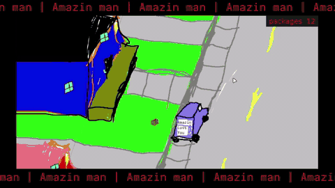

# Amazin Man

[](https://wwel.sh/digest.html?repo=amazin-man)

Modern Paperboy. Built with [LÖVE](https://love2d.org) for an arcade machine I'm making with friends.



## Run

```
love .
```

## Test

```
./tests/run.sh
```

## License

MIT
